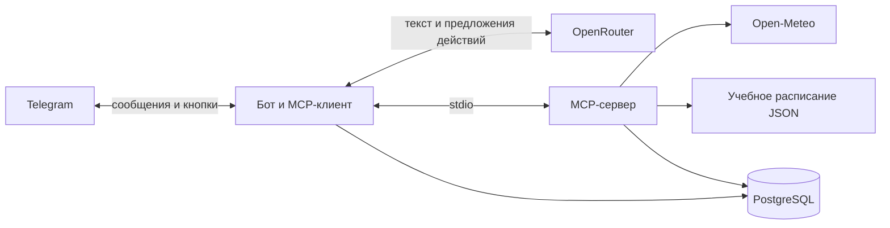

# Как работает лабораторная № 2

В [лабораторной № 1](lab1-explained.md) бот отвечал текстом через OpenRouter. Во второй работе он может прочитать погоду и расписание или подготовить напоминание. Модель предлагает действие и его параметры. Код бота проверяет предложение, обращается к MCP-серверу и формирует ответ по полученным данным. Для записи напоминания бот запрашивает согласие кнопкой.

## Компоненты

| Компонент | За что отвечает |
| --- | --- |
| Telegram-бот | Принимает текст и нажатия кнопок. Собирает контекст диалога, вызывает модель, управляет инструментами и отправляет ответы. |
| OpenRouter | Передаёт запрос языковой модели. В ответе модель может вернуть текст или структурированное предложение вызвать функцию. |
| MCP-клиент | Работает внутри бота. Получает список инструментов и ресурсов, отправляет вызовы и проверяет результаты. |
| MCP-сервер | Запускается отдельным дочерним процессом. Читает данные Open-Meteo и учебный JSON, сохраняет подтверждённые напоминания в PostgreSQL. |
| PostgreSQL | Хранит историю, настройки, часовые пояса, черновики, созданные напоминания и аудит решений. |

MCP (*Model Context Protocol*) задаёт формат общения приложения с сервером инструментов. Здесь соединение использует `stdio` — стандартные потоки ввода и вывода дочернего процесса. При запуске бот проверяет Telegram и PostgreSQL, применяет миграции, запускает MCP-процесс и обнаруживает его возможности. [Точка входа](../app/__main__.py) · [MCP-клиент](../app/mcp_tools/client.py)

## Инструменты и ресурс

Для каждого инструмента сервер объявляет JSON-схему аргументов и схему результата. Схема описывает названия полей, типы и ограничения значений. Бот передаёт модели описания разрешённых инструментов. При вызове сервер повторно проверяет аргументы и возвращает структурированные данные. [Контракты](../app/mcp_tools/contracts.py) · [MCP-сервер](../app/mcp_tools/server.py)

| Имя | Тип | Что возвращает |
| --- | --- | --- |
| `get_weather` | Чтение | Текущую температуру, условия, ветер, время и зону наблюдения. Если геокодер нашёл несколько вариантов, бот просит уточнить область или страну. |
| `get_schedule` | Чтение | Занятия на дату `YYYY-MM-DD` со временем, названием и местом. Пустой список означает, что в учебном файле на эту дату занятий нет. |
| `add_reminder` | Запись после подтверждения | Идентификатор записи, время, часовой пояс и признак, что запись создана этим вызовом. |
| `schedule://current-week` | Ресурс MCP | Расписание на семь дней с понедельника по воскресенье в зоне `SCHEDULE_TIMEZONE`. Независимый MCP-клиент читает ресурс по его адресу. |

## Путь одного запроса

Возьмём сообщение «Покажи расписание на 12 октября 2026 года».

1. **Бот принимает сообщение.** Обработчик Telegram передаёт текст, идентификатор пользователя и номер обновления. Сервис загружает из PostgreSQL режим, температуру и недавние реплики.
2. **Модель предлагает действие.** В запросе к OpenRouter есть контекст диалога и описания инструментов. Модель может ответить текстом, запросить уточнение или предложить нативный вызов через `tool_calls`. В этом примере ожидаемый вызов — `get_schedule` с датой `2026-10-12`.
3. **Бот проверяет предложение.** Маршрутизатор сверяет имя инструмента и поля аргументов. Для расписания он проверяет формат даты, её существование и попадание в диапазон 2000–2099 годов.
4. **MCP-сервер читает расписание.** Сервер проверяет аргументы и читает учебный JSON. Клиент проверяет схему ответа и сверяет дату с запросом. На эту дату в файле два занятия, первое — «Алгоритмы и структуры данных» с 10:00 до 11:30.
5. **Бот формирует ответ и пишет аудит.** Код подставляет проверенные поля в сообщение для Telegram. После успешного чтения модель получает только нужные структурированные данные отдельным сообщением с ролью `tool`. Например, для расписания ей передаются дата и часы занятий, а названия и аудитории бот выводит напрямую. Следующий шаг модели может предложить ещё одно чтение или уточнение. На одно сообщение разрешено до двух вызовов MCP. При попытке третьего бот сообщает о лимите и сохраняет причину в аудите.

[Обработчик Telegram](../app/handlers/assistant.py) · [Маршрутизатор](../app/agent_router.py) · [Агентный цикл](../app/agent.py) · [Учебное расписание](../app/mcp_tools/data/schedule.json)

## Почему напоминание требует кнопки

После команды `/timezone Europe/Moscow` напишите «Напомни завтра в 18:30 отправить отчёт».

1. **Подготовка.** Модель выделяет текст задачи и время. Бот переводит локальное время из сохранённой зоны в UTC и сохраняет черновик в `reminder_actions`. Бот показывает дату, время, зону и кнопки «Подтвердить» и «Отменить». Согласие можно дать в течение пяти минут.
2. **Подтверждение.** Telegram передаёт идентификатор пользователя, который нажал кнопку. Бот сверяет его с владельцем черновика и проверяет срок и состояние. Затем вызывает `add_reminder` через MCP. К аргументам инструмента бот добавляет отдельные метаданные с идентификатором владельца и черновика. Подпись HMAC связывает эти поля с точными аргументами. Её проверяют с помощью ключа, общего для бота и его MCP-сервера.
3. **Запись.** MCP-сервер проверяет подпись и согласие в PostgreSQL. Транзакция блокирует строку черновика, создаёт запись в `reminders` и помечает действие выполненным. Бот сообщает идентификатор и точное время.

Повторная доставка того же обновления Telegram находит прежний черновик по паре «владелец, номер обновления». Повтор подтверждения выполненного действия возвращает прежний идентификатор. Отмена, истёкший срок и попытка подтвердить чужой черновик блокируют запись. При переводе часов некоторые значения местного времени пропускаются или повторяются. В таких случаях бот просит уточнить время. Планировщик отправки уведомлений относится к лабораторной № 3. [Время](../app/reminders.py) · [Подпись](../app/mcp_tools/auth.py) · [Хранилище и транзакции](../app/store.py)

## Команды и сбои

| Команда | Что увидит пользователь |
| --- | --- |
| `/start` | Список команд, включая режимы и настройки первой работы. |
| `/tools` | Обнаруженные MCP-инструменты и их типы — чтение или запись с подтверждением. |
| `/timezone Europe/Moscow` | Сохранённую зону и текущее время в ней. `/timezone` без аргумента показывает текущую настройку. |
| `/why` | Последнее решение по своему запросу, название инструмента, безопасное резюме аргументов, результат проверки и выполнения, длительность и причину. |

При сбое MCP обычные ответы модели остаются доступны. Для запроса с инструментом бот сообщает о недоступности. Ошибки аргументов, отсутствие города и тайм-аут Open-Meteo обрабатываются до выдачи результата пользователю. [Обработка ответов и аудит](../app/agent.py)

## Как показать работу

1. Запустите бота по [инструкции в README](../README.md) и отправьте `/tools`. В списке будут три инструмента.
2. Отправьте «Покажи расписание на 12 октября 2026 года», затем `/why`. В ответе будут занятия с указанием учебного источника. В аудите появится `get_schedule`.
3. Установите `/timezone Europe/Moscow` и попросите напомнить о задаче завтра в 18:30. Посмотрите черновик, нажмите «Подтвердить» и проверьте идентификатор и время в ответе. Для демонстрации отмены создайте другой черновик.
4. Из активированной `.venv` запустите `python -m scripts.check_mcp`. Независимый клиент читает расписание и ресурс, а неподписанный запрос на запись получает `unauthorized`.

В эксперименте модель на закреплённом эндпоинте OpenRouter обработала 12 запросов. Итоговый прогон дал 12/12 верных действий и 8/9 верных аргументов. Аргументы напоминаний оценивались до подтверждения. Живая проверка текущей погоды завершилась тайм-аутом Open-Meteo, а успешный ответ проверен с подменой погодного API. [Эксперимент](evaluation/lab2-routing-results.md) · [Отчёт](lab2-report.md)
