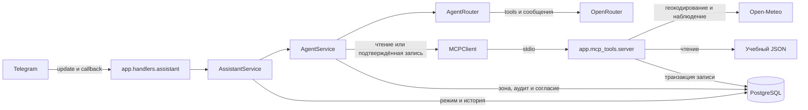

# Лабораторная работа № 2. Telegram-агент с MCP-инструментами

- **Университет** ИТМО
- **Дисциплина** «Разработка AI-ассистента в Telegram»
- **Студент и группа** [заполнить студенту]
- **Город и год** Санкт-Петербург, 2026
- **Репозиторий** [s1zenOne/itmo-tg-template](https://github.com/s1zenOne/itmo-tg-template)
- **Локальный аннотированный тег** `lab2`

**Дополнение 24.11.2026 для текущей версии после лабораторной № 3.** Предложение модели сверяется с полной задачей исходного запроса; карточка и запись получают исходный текст, включая регистр, пробелы и завершающие знаки. Поддержаны «завтра в 17» и ограниченные относительные интервалы, в том числе «через два часа». Неоднозначные формулировки требуют уточнения. Тесты трёх запросов базового набора проверяют время, владельца, текст и отсутствие записи до подтверждения. Эти результаты не заменяют исходную серию реальной модели, описанную ниже. Реальный запрос модели на напоминание с подтверждением остаётся проверить в Telegram: предыдущая попытка упёрлась в бесплатный лимит, а доставка была проверена с подменой решения модели. Существующий тег `lab2` не переназначался и не включает последующие исправления.

## 1. Цель и условия работы

Бот выбирает между ответом, уточнением и вызовом инструмента. Через отдельный MCP-процесс он читает актуальную погоду и учебное расписание, а после подтверждения создаёт напоминания в PostgreSQL. Режимы первой работы, история и настройки остаются доступны в личном чате.

Среда проверки — macOS 26.6.2, Python 3.12.16, aiogram 3.31.0, aiohttp 3.14.3, asyncpg 0.31.0, MCP Python SDK 2.3.0. Конкурентные проверки выполнены на временной PostgreSQL 18.6 с приватным Unix-сокетом. Сценарии хранения первой работы проверены также на PostgreSQL 16 в Docker. OpenRouter использует Chat Completions API с нативными вызовами функций.

## 2. Архитектура

На рисунке 1 показаны связи между обработчиком Telegram, маршрутизатором, MCP и хранилищем. Telegram update определяет владельца и ключ подготовки. Параметры модели проходят через маршрутизатор до доступа к инструменту.

*Рисунок 1 — компоненты Telegram-агента и границы обмена.*

`MCPClient` обнаруживает схемы и ресурс при старте и закрывает соединение при остановке процесса. При сбое соединения маршрутизатор получает возможность сообщить о недоступности инструмента и продолжает обычный диалог. Команда `/tools` использует метаданные обнаруженных инструментов. [Подключение](../app/mcp_tools/client.py), [точка входа](../app/__main__.py).

Маршрутизатор передаёт схему каждого доступного инструмента и служебную функцию уточнения. Он проверяет JSON, лишние поля, имя и семантику аргументов. Сервер проверяет аргументы повторно. Хост принимает только структурированный результат с ожидаемыми полями и статусом. Проверенные числовые и календарные поля возвращаются модели в сообщении с ролью `tool`. Свободный текст источника остаётся в отображении пользователю. После чтения маршрутизатор может предложить второе чтение. Третья попытка останавливает цикл и записывается в аудит. [Маршрутизатор](../app/agent_router.py), [агент](../app/agent.py), [контракты](../app/mcp_tools/contracts.py).

## 3. Инструменты и состояния

Таблица 1 связывает возможности MCP с результатами, которые видит бот.

| Возможность | Аргументы | Результат и источник |
| --- | --- | --- |
| `get_weather` | Город длиной 1–100 символов, при необходимости со страной или областью | Город, страна, температура в °C, условия, ветер в км/ч, момент наблюдения и зона. При совпадении названий возвращает варианты для уточнения. |
| `get_schedule` | Реальная дата `YYYY-MM-DD` в 2000–2099 годах | `start`, `end`, `title`, `location` для каждого занятия в учебном JSON. Пустой список означает отсутствие занятий в источнике. |
| `add_reminder` | Текст длиной 1–500 символов и будущий момент с явным смещением | ID, время, зона и признак создания. Источник — транзакция PostgreSQL с проверкой подтверждения. |
| `schedule://current-week` | URI и зона источника из конфигурации | Семь записей с понедельника по воскресенье, сгруппированных по датам. |

*Таблица 1 — контракты инструментов и ресурса.*

Open-Meteo предоставляет геокодер и текущие погодные данные через два документированных HTTP-эндпоинта. Геокодер возвращает страну, административную область и координаты, а погодный API — наблюдение с единицами измерения и часовой зоной. Чтение использует конечный тайм-аут и ограниченный повтор. Учебное расписание обезличено. Путь и зона настраиваются при запуске. [Геокодер Open-Meteo](https://open-meteo.com/en/docs/geocoding-api), [погодный API Open-Meteo](https://open-meteo.com/en/docs), [учебные данные](../app/mcp_tools/data/schedule.json).

### Подтверждение напоминания

1. Хост извлекает владельца из Telegram update и нормализует предложенное время. Локальное время разрешается в сохранённой IANA-зоне. Пропущенный или повторяющийся час на переводе часов требует уточнения. Смещение, предложенное моделью, проверяется по тексту запроса и сохранённой зоне.
2. `reminder_actions` хранит подготовленное действие, владельца, нормализованный момент, зону и срок. Уникальность `(owner_id, update_id)` обеспечивает одну подготовку. Пользователь видит параметры и кнопки. Изменённый запрос получает собственное подтверждение. Отмена и истечение пяти минут закрывают возможность новой записи.
3. Хост записывает согласие владельца. Он передаёт владельца и UUID действия через подписанные метаданные MCP. Ключ HMAC генерируется в хосте и передаётся его дочернему серверу. Подпись связывает точные аргументы, владельца и действие. Модель видит только `text` и `remind_at`. Независимый клиент получает `unauthorized` без подписи, а подмена владельца, UUID или параметров нарушает проверку подписи.
4. Сервер блокирует строку действия в PostgreSQL и проверяет владельца, параметры, состояние и время. Запись и переход в выполненное состояние проходят в одной транзакции. Уникальная связь напоминания с действием защищает от дубликатов. Авторизованный повтор возвращает прежний ID и момент с `created=false`, в том числе при потере первого ответа.

[Нормализация времени](../app/reminders.py), [подпись контекста](../app/mcp_tools/auth.py), [SQL-миграция](../app/migrations/0002_lab2.sql), [хранилище](../app/store.py).

## 4. Проверки

16 ноября 2026 года запуск из `.venv` дал `172 passed, 4 skipped`. С `RUN_INTEGRATION=1` и `RUN_LAB2_POSTGRES=1` прошли все 176 тестов. `ruff check .`, `ruff format --check .` и `pip check` завершились успешно. С пустым системным `TZPATH` зона `Europe/Moscow` загрузилась из пакета `tzdata`. Это проверяет резервный источник IANA для Windows.

Тесты с подменой Telegram, OpenRouter и погоды проверили 14 обязательных сценариев и дополнительные случаи. Временная PostgreSQL подтвердила одну подготовленную операцию и одно напоминание после повторного update, двух подтверждений и потери первого ответа. В отдельном тесте подписанный вызов через stdio создал запись с тестовой идентичностью и вернул её при повторе. [Агент](../tests/test_agent.py), [MCP](../tests/test_mcp_tools.py), [PostgreSQL](../tests/test_lab2_postgres.py).

Независимый `python -m scripts.check_mcp` обнаружил три инструмента и один ресурс, проверил входные и выходные схемы, прочитал два занятия 12 октября и семь дней ресурса. Прямой `add_reminder` ответил `unauthorized`. Живой геокодер вернул две Казани в разных регионах России. Попытка получить текущую сводку после уточнения завершилась `weather_timeout`. Успешный ответ с температурой, ветром и временем проверен через MCP с подменой погодного HTTP. Для живой проверки сводки нужен доступ к Open-Meteo из окружения бота. [Независимая проверка](../scripts/check_mcp.py).

Обычный `python -m app` в Docker подключился к Telegram и временной PostgreSQL 16, применил две миграции, обнаружил MCP и запустил polling. `python -m app.healthcheck` подтвердил готовность. По SIGTERM приложение завершилось с кодом 0. Сквозной запрос расписания к живому OpenRouter прошёл через stdio, а аудит отметил чтение как успешное. Образ собран из архива развёртывания и прошёл независимую проверку MCP. Файлы расписания и миграций совпали с исходниками.

**Дополнительная проверка 24.11.2026.** В личном чате текущая версия после лабораторной № 3 с временной PostgreSQL ответила на `/tools`, `/timezone` и запрос недельного расписания. Явный запрос погоды для Санкт-Петербурга через Open-Meteo вернул температуру 1,4 °C, слабую морось, ветер 11,5 км/ч и время наблюдения 00:45 по Europe/Moscow. Это живой результат текущей версии, а не повтор исходного эксперимента лабораторной № 2. При последующем запросе напоминания бот сообщил об исчерпании бесплатного лимита OpenRouter. В отдельном запуске с контролируемой подменой решения модели пользователь подтвердил тестовую карточку, MCP сохранил одно напоминание в тестовую PostgreSQL, а текущая версия после лабораторной № 3 доставила его в Telegram после перезапуска. Подмена не подтверждает работу модели на этом запросе.

**Учебная проверка двух пользователей.** Переносимый `tests/test_lab1_submission_demo.py` прошёл на этой версии с временной PostgreSQL и подменёнными Telegram и LLM. Он проверяет базовые режимы первой работы, сохранение раздельных настроек и историй после пересоздания сервисов, изолированный сброс, длинный ответ и обработку таймаута. В версии лабораторной № 2 сценарий использует `AssistantService` без агента, поэтому не заменяет проверки MCP и маршрутизации этой работы. Команда: `RUN_LAB1_SUBMISSION_DEMO=1 .venv/bin/python -m pytest -q tests/test_lab1_submission_demo.py`.

В таблице 2 приведены наблюдения негативных сценариев. Тесты проверяют сообщения пользователю и отсутствие запрещённого вызова или записи.

| Сценарий | Ожидание | Наблюдение |
| --- | --- | --- |
| Модель предложила неизвестный инструмент | Отклонить действие и объяснить отказ | Бот сообщил о недоступном инструменте. Вызовов MCP и подготовленных напоминаний нет. |
| Строка занятия имитирует инструкцию вызвать `add_reminder` | Обработать её как данные и сохранить запрет записи | Строка отображена в поле занятия, в сообщение модели попали только часы. Хост отклонил последующее предложение записи. В MCP ушло одно чтение. |
| Модель предложила прошедшее время | Запросить время в будущем | Бот сообщил, что время прошло. Карточка согласия и запись не созданы. |
| MCP потерял соединение или вернул неполный ответ | Сообщить о сбое | Бот сообщил о недоступности или некорректных данных. Аудит отметил остановку. |
| Третье предложение чтения | Остановить цикл и отметить лимит | MCP получил два вызова. Бот сообщил о лимите, причина сохранена в аудите. |

*Таблица 2 — ожидаемое и фактическое поведение при ошибках.*

## 5. Эксперимент

Для всех трёх серий закреплены эндпоинт `nvidia/nvfp4`, ревизия `nvidia/nemotron-3.5-lightning-20260807:free` и температура 0. Модель получала дату и зону из набора. Стоимость итоговых запросов по метаданным OpenRouter равна нулю. Все запросы использовали изолированный контекст. Аргументы напоминаний проверялись без записи.

Исходная серия дала 10/12 верных действий и 6/9 верных аргументов. Изменено только описание `add_reminder` для модели. При повторе трёх промахов верны два действия и два набора аргументов. Итоговый полный прогон дал **12/12 действий и 8/9 аргументов**. В одном запросе модель верно выбрала напоминание, а валидатор отклонил прошедший момент. Все строки, правила эквивалентности аргументов и JSON-журналы приведены в приложении. [Результаты эксперимента](evaluation/lab2-routing-results.md).

## 6. Безопасность и ограничения

В `/why` видны только записи текущего владельца. Аудит хранит тип операции, дату или время, длину произвольных строк, статусы, длительность и причину из кода. Применение подписи и проверка PostgreSQL ограничивают запись независимо от решения модели. В логах используются случайные ID запросов. Системные инструкции и скрытые рассуждения закрыты. Точные совпадения фраз инструкции в ответах и явные запросы на раскрытие обрабатываются отказом.

Погода описывает текущее наблюдение. Расписание читается из учебного файла, часы зависят от указанной зоны. Напоминания сохраняются без отправки уведомлений. Граница доверия включает процессы хоста и его дочернего сервера, их окружение и доступ к PostgreSQL. Бесплатные маршруты могут временно возвращать ограничения провайдера.

## 7. Использование ИИ

Codex применялся для проектирования, реализации, автоматических проверок и анализа эксперимента. В первой реализации подписи помощник вызвал `model_validate` и `model_dump` для `RequestParamsMeta`. Независимая проверка показала ошибку вызова. В SDK 2.3.0 этот тип объявлен как открытый `TypedDict`. Код исправлен на чтение и формирование словаря, после чего прошли проверки неподписанного запроса, подделки и подписанной записи на PostgreSQL. [Исправленная проверка контекста](../app/mcp_tools/auth.py).

## 8. Вывод

Реализованы два чтения, подтверждаемая запись, ограничение цикла и аудит с изоляцией владельцев. Итоговая серия достигла двух порогов маршрутизации. Проверенную версию отмечает тег `lab2`. Дополнительная живая проверка успешной погодной сводки зависит от доступности Open-Meteo.

## Источники

- Методичка лабораторной и правила подготовки отчёта. [Лабораторная № 2](labs-guide.md#lab2), [приложение Б](labs-guide.md#appendix-report).
- MCP Python SDK версии 2.3.0 и спецификация инструментов и ресурсов. [SDK](https://pypi.org/project/mcp/2.3.0/), [инструменты](https://modelcontextprotocol.io/specification/2026-07-28/server/tools), [ресурсы](https://modelcontextprotocol.io/specification/2026-07-28/server/resources).
- Нативные вызовы функций и закрепление провайдера. [OpenRouter Tool Calling](https://openrouter.ai/docs/guides/features/tool-calling), [Provider Routing](https://openrouter.ai/docs/guides/routing/provider-selection).
- Внешнее наблюдение и поиск города. [Open-Meteo](https://open-meteo.com/en/docs), [Geocoding API](https://open-meteo.com/en/docs/geocoding-api).
